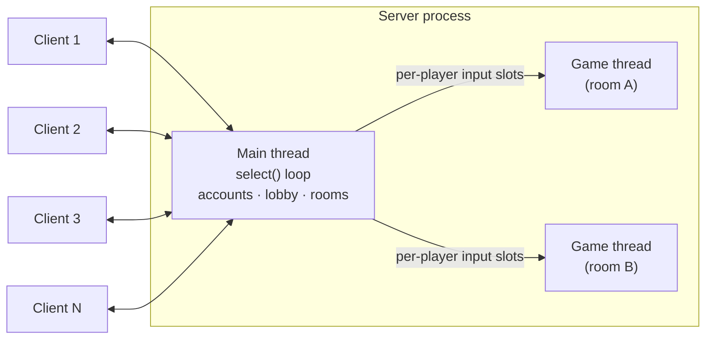

# Multiplayer UNO with Chat Room (C++ Socket Programming)


A networked, four-player **UNO** card game with accounts, a lobby, game rooms and an in-game **chat room**, written in C++ on top of BSD sockets. Players connect to a central server from terminal clients, play UNO against each other in real time, and chat during the game.

Final project for a network programming course (2024).

---

## Architecture



### Concurrency model

- **I/O multiplexing with `select()`.** A single main thread watches the listening socket and every client socket with `select()`. It accepts new connections, reads commands, and runs a per-client state machine: `MENU → LOGIN / REGISTER → LOBBY → WAITING (in a room) → IN GAME → RESULT → LOBBY`.
- **One thread per game.** When a room's host starts a game, the server spawns a detached **pthread** that owns that game's state (deck, hands, turn order, direction, pending draw penalty). The game thread runs on a 1-second tick timer.
- **Hand-off between threads.** While a game is running, the main thread stores each player's latest input in that room's per-player slot (`gamechat[room][player]`); the game thread polls these slots on every tick, applies moves or chat messages, and writes the updated game view directly to the players' sockets.

### Protocol

Plain text over TCP:

| Direction | Format |
| --- | --- |
| Client → server | Each line is prefixed with `$`; the server splits incoming data on `$` into commands. |
| Server → client | Tokens separated by `@`. Control tokens switch the client's screen (`menu`, `login`, `register`, `lobby`, `room`, `game`, `win`, `exit`) or carry game data; any other token is printed as text. A leading `clr` token clears the screen (added automatically unless the server message starts with `%`). |

In-game messages:

| Message | Meaning |
| --- | --- |
| `#<color> <number> [<chosen color>]` (client → server) | Play a card (a chosen color is sent for Wild cards) |
| `#draw` (client → server) | Draw one card, or all pending penalty cards |
| `leave` (client → server) | Quit the game (ends it for everyone) |
| any other text (client → server) | Chat message |
| `hand@<color> <number> …` | Cards dealt to / drawn by this player |
| `card@<color> <number>` | Current top card |
| `turn` / `add` / `disp` | It is your turn / a +2 or +4 penalty is pending / redraw the game screen |

Cards are encoded as `(color, number)` pairs: colors `1`–`4` are red, green, yellow, blue and `5` is wild; numbers `0`–`9` are number cards, `10` Skip, `11` Reverse, `12` Draw Two, `13` Wild, `14` Wild Draw Four.

---

## Features

### Accounts and lobby
- **Register / login / logout**; accounts are stored in `server/user.txt`, and an account can only be logged in from one client at a time
- **Lobby** with a live room list (host, players `n / 4`, in-game flag) and an online-player list with each player's status, pushed to every client in the lobby whenever something changes

### Game rooms
- **Create** a room (the creator becomes the host), **join `<roomid>`**, or **join** with no ID to enter the first room that is not full
- The host can **start** the game once the room has exactly **4 players**; leaving as the host closes the room

### UNO rules
- 112-card deck: two of each number `0`–`9`, Skip, Reverse and Draw Two in every color, plus 4 Wild and 4 Wild Draw Four cards; 7 cards dealt to each player
- A card can be played if it matches the current card's color or symbol, or if it is a Wild card (the player then chooses a color); the first player may play any card
- **Skip**, **Reverse**, **Draw Two**, **Wild** and **Wild Draw Four** are implemented
- **Stacking:** while a draw penalty is pending, the next player may stack another card of the same type or a Wild Draw Four (not a Draw Two on a Wild Draw Four); otherwise they must draw all accumulated cards
- When the draw pile runs out, the played cards are shuffled back into it
- The first player to empty their hand wins; the result screen shows the final table, every hand, the elapsed time and the winner

### Chat and terminal UI
- During a game, anything a player types that is not a move is broadcast to the room, and the full chat history is shown above the game view
- Card colors are rendered with ANSI escape codes and special cards with symbols (`Φ` Skip, `╰╮` Reverse, `+2`, `⊕` Wild, `+4`); lobby and room lists are drawn as Unicode tables
- The client shows the player's hand with card IDs and the other players' card counts, and checks moves locally before sending them (matching color/symbol, color choice for Wild cards, stacking rules)

---

## Getting Started

**Requirements:** Linux (or another Unix-like system), `make` and `g++` with C++17 support.

```bash
# Terminal 1 — server (run inside server/, it reads and writes user.txt)
cd server
make
./server            # listens on TCP port 15023

# Terminals 2–5 — one client per player
cd client
make
./client            # connects to 127.0.0.1:15023
```

The server port (`15023`) and the client's server address (`127.0.0.1`) are set in `server/server.cpp` and `client/client.cpp`; change them to play across machines.

In the client, type the commands shown on each screen, e.g. `register` / `login`, then `<username> <password>`, then `create` or `join <roomid>`, and `start` as the host. During your turn, play a card with `#<card_id>` (add a color `1`–`4` for Wild cards) or draw with `#draw`.

## Project Structure

```
2024_Network_Final/
├── server/
│   ├── server.cpp     # select() loop, accounts, lobby, rooms, per-game threads and UNO logic
│   ├── Timer.hpp/.cpp # Tick timer used by the game threads
│   ├── user.txt       # Account store (username password)
│   └── Makefile
├── client/
│   ├── client.cpp     # Terminal client: select() on stdin + socket, UI, local move checks
│   └── Makefile
├── unp.h              # Header from UNIX Network Programming
├── config.h           # Platform configuration for unp.h
└── Make.defines       # Shared build settings from UNIX Network Programming
```

## Credits

- `unp.h`, `config.h` and `Make.defines` come from the source code of W. Richard Stevens' *UNIX Network Programming*, and the server's `select()` loop is based on the book's `select()`-based TCP server example (the `include fig01` / `end fig02` markers in `server.cpp` come from it).
- `Timer.hpp` / `Timer.cpp` (`F2::Timer`) are taken from the "2f" 2D game engine, as stated in the file header.

---

## Author

**Ricky Chou** · [@RickyChou030](https://github.com/RickyChou030)
